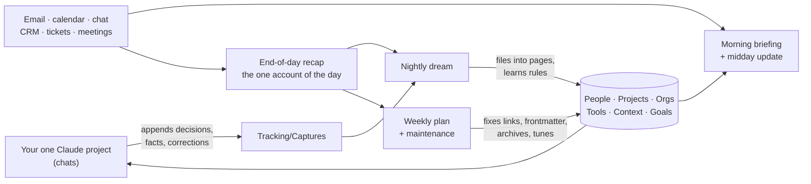

# Claude Workbench

One plugin that gives you a second brain Claude can actually run. It interviews you, builds a
folder of plain markdown around your role, company and tools, wires up the scheduled routines
that keep it current, and sets you up to do all your work from a single Claude project. After
that the workbench maintains itself, and it gets better every time you correct it.

**New here? Start with the visual walkthrough:** [`docs/index.html`](docs/index.html). Download it
and open it in a browser, or serve the repo with GitHub Pages. It covers setup, the folder, the
routines, how it learns, and every skill, tab by tab.

It's the public, company-neutral version of a setup that's been running daily since September
2026. Nothing in it names a company, a person or a tool instance. Everything specific to you is
gathered during onboarding.

## What you get

```
~/Workbench/
├── CLAUDE.md            the operating contract: folder map, who writes what, conventions
├── Context/             how you work (me.md), how you write (voice.md), your org
├── Daily/               briefings, recaps, calendar copies, weekly plans (routine-written)
├── Projects/            one page per project + INDEX.md
├── People/              one page per person + NAME_VARIANTS.md
├── Organizations/       employer, customers, vendors, partners
├── Resources/           reference material, Tools/, GLOSSARY.md
├── Tracking/            GOALS, FRICTION_LOG, DREAM_LOG, IMPROVEMENTS, Captures/, Drafts/, Signals/
├── Meetings/            only if your meeting recorder exports notes
└── Archive/             closed chapters, read-only
```

Pages are connected through **relationship properties** in their frontmatter: a person's `org`,
`reports_to` and `projects`; a project's `owner`, `people`, `orgs` and `tools`; an org's `people`.
Values are quoted wikilinks, so Obsidian's graph and backlinks use them, and every edge is kept on
both pages. The nightly dream builds them from each day's recap and captures, and the weekly repairs
any edge that's one-sided.

Every folder carries its own `CLAUDE.md` with the schema and a page shape to copy, so there's no
templates folder to drift out of sync.

## How it runs



| Routine | Default time | Writes |
|---|---|---|
| Calendar Sync | before work, 11:30, end of day | `Daily/<date>_CALENDAR.md` |
| Morning Briefing | 30 min before work | `Daily/<date>_MORNING_BRIEFING.md` |
| Midday Update | 12:00 | appends to the briefing |
| End-of-Day Recap | 30 min after work | `Daily/<date>_DAILY_RECAP.md`, grades the briefing |
| Nightly Dream | 22:00 | dream-owned blocks on pages, `DREAM_LOG.md` |
| Weekly Plan & Maintenance | 90 min before work, first workday | next-week plan, librarian fixes, archive moves, threshold tuning |

Times come from your working hours and timezone, and you can switch any routine off.

A few rules hold the whole thing together:

- **One writer per file.** Each routine owns specific files and writes nothing else. Your chats
  write only to `Tracking/Captures/`. Nothing races anything.
- **The recap is the record.** Sources reach the vault once, through the recap. The dream and
  the weekly build on it instead of re-reading your inbox and arriving at a different story.
- **Nothing is deleted.** Facts that stop being true are demoted to `superseded` with a link to
  what replaced them, then archived. Every ledger line carries a source, a date and a state.
- **It measures itself.** The briefing makes checkable claims, the recap grades them, and the
  weekly only moves the confidence bar when there's enough evidence.

## Getting the day without opening the folder

Most people won't browse a folder every morning, so setup asks how the briefing should reach you:

| Channel | What happens |
|---|---|
| Slack | a DM to yourself with today's focus, risks and numbered questions; reply in the thread |
| Email | the same digest in your inbox; reply to it |
| Claude | the digest is the scheduled task's message in the Claude app; answer in your project |
| None | just the file in `Daily/` |

Setup sends a test message so you know it works. Answers ("1 yes, 2 it's Jo Tan") flow back
through the recap or your project's captures, and the dream acts on them that night. Sending the
digest to you is the one thing a routine may send, and only ever to you.

For browsing, setup suggests [Obsidian](https://obsidian.md) and ships a starter config with a
colored graph of people, projects and orgs.

## The self-improving part

It learns from three things, and it measures each instead of assuming:

- **Your corrections.** Correct Claude in your project and it logs a `correction:` line. That night
  the dream turns it into a rule in `Context/voice.md` or `Context/me.md`. If the same correction
  comes back later, the weekly flags the rule as not working.
- **What you actually send.** Every draft Claude hands you is saved to `Tracking/Drafts/`. The
  end-of-day recap compares it with what you really sent (verbatim, light edit, rewrite, not sent).
  When the same kind of edit shows up twice, the dream writes it into your voice rules.
- **What it proposes.** When the dream spots repeated manual work or friction, it proposes a fix: a
  rule, a skill, a routine change, a connector. The weekly logs it in `Tracking/IMPROVEMENTS.md`,
  asks you about it, and later checks whether it got built and whether the problem went away.

Every week a short scorecard answers "is it getting better?": draft acceptance rate, heavy edits,
briefing accuracy, repeat corrections, questions answered, improvements adopted. You stay in
control of the `CLAUDE.md` contracts; routines can propose changes to them but never write them.

## Install

In Claude Code or Cowork:

```
/plugin marketplace add jwm-axoni/claude-workbench
/plugin install workbench@claude-workbench
```

Then run `/workbench:setup` and answer a few questions. It takes about ten minutes.

You need Python 3 on the machine that runs setup (macOS and most Linux installs have it). For the
routines you need either Claude desktop/Cowork scheduled tasks, with the computer awake at those
times, or cloud routines with the workbench in a private GitHub repo.

## Skills and commands

| | What it does |
|---|---|
| `/workbench:setup` | Onboarding interview, connector check, builds the folder, hands off to scheduling, writes your project instructions. Re-run it any time your role, tools or hours change. |
| `/workbench:schedules` | Makes your scheduled tasks match the plan: finds existing `[Workbench]` tasks and older look-alikes, then updates, replaces or removes them. No duplicates. |
| `/workbench:migrate` | Upgrades after a plugin update without touching your edits, resolves `.workbench-new` conflicts, and brings an older vault into the layout. |
| `/workbench:librarian` | Read-only health audit: frontmatter, broken links, duplicates, stale pages, unfiled captures, routine misses. |
| `/workbench:capture` | The one way a chat writes to the vault. Usually automatic. |
| `/workbench:daily-briefing`, `eod-recap`, `nightly-dream`, `weekly-review`, `calendar-sync` | The routines. They run on schedule, and you can also run any of them by hand. |
| `/workbench:person <name>` | Everything the vault knows about someone. Read-only. |
| `/workbench:project <name>` | Where a project stands, what's decided, what's owed. Read-only. |
| `/workbench:vault-search <question>` | Search with the vault's rules applied: name variants, trust order, no transcript bodies. |

## The one-project setup

After setup, create one Claude project called "<Your name>'s Workbench" with the workbench folder
attached, and paste in the instructions from `.workbench/PROJECT_INSTRUCTIONS.md`. They have four
parts: READ (the vault first, in a set order, citing pages), CAPTURE (log decisions, process
changes, facts, corrections and briefing answers as they're settled), DRAFTS (save every draft
handed over), and WRITE (captures and drafts only; nothing else without asking). Do your work
there. Every chat reads the same memory, and everything a chat settles flows back into the vault. Separate projects per topic split your memory; this setup keeps it whole.

## Safe upgrades

The plugin records a hash of every file it writes in `.workbench/manifest.json`. On upgrade:

- files nobody touched are refreshed
- files you edited are left alone, and the new version lands beside them as `*.workbench-new`
- content pages (people, projects, goals, logs) are never rewritten by the plugin

`/workbench:migrate` walks you through merging any `.workbench-new` files.

## Role packs

Onboarding picks a role pack from your title, and you can override it: sales, customer success,
marketing, engineering, product, operations, people, IT/security, finance, leadership, or general.
A pack sets the tag vocabulary, which sources the recap sweeps first, what the briefing and weekly
watch for, the connectors worth adding, and any guardrails (the people pack, for example, keeps
candidate and employee personal data out of the vault).

## Privacy

The workbench holds real names and internal detail on your machine (or in your private repo). The
routines read your tools and never send, post or change anything in them. Calendar copies strip
passcodes and show external attendees as a count and domain only. Keep any repo private and never
commit secrets.

## Development

```bash
python3 -m unittest discover -s tests
claude plugin validate .
```

`scripts/workbench.py` is the stdlib-only scaffolder that every skill calls. `blueprints/` defines
the layout, routines and role packs. `templates/` holds the pages it renders. See `CLAUDE.md` for
contributor notes.

## License

MIT
